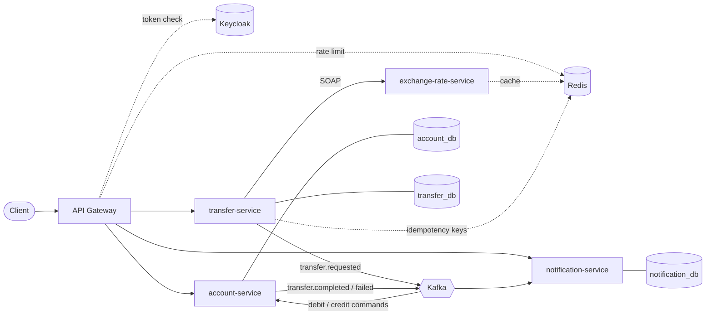

# Digital Bank

[](https://github.com/abdullaabdullayev/digital-bank/actions/workflows/ci.yml)


A microservices core-banking platform: customer accounts with a double-entry ledger, money
transfers coordinated through **Kafka** (saga pattern), **Redis** for idempotency, caching and
rate limiting, a **SOAP** exchange-rate service, and **Kubernetes** deployment.

> Built in stages. Each stage is a separate pull request with tests and CI; see the [roadmap](#roadmap).

## Target architecture



| Service | Responsibility | Status |
|---|---|---|
| `common` | Money type, RFC 7807 error handling shared by all services | ✅ |
| `account-service` | Customers, accounts, double-entry ledger, balances | ⏳ |
| `gateway` | Routing, OAuth2 token relay, Redis rate limiting | ⏳ |
| `transfer-service` | Transfer API, outbox, Kafka saga, idempotency | ⏳ |
| `exchange-rate-service` | SOAP endpoint (WSDL-first) and CBAR rate import | ⏳ |
| `notification-service` | Kafka consumer, e-mail notifications, dead-letter replay | ⏳ |

## Design principles

- **Money is never a `double`.** [`Money`](common/src/main/java/com/digitalbank/common/money/Money.java)
  wraps `BigDecimal` with the currency's scale and banker's rounding, and refuses to mix currencies
  without an explicit conversion.
- **One error format everywhere.** Every service returns RFC 7807 `application/problem+json` with a
  stable `code` field ([`GlobalExceptionHandler`](common/src/main/java/com/digitalbank/common/error/GlobalExceptionHandler.java)),
  registered automatically through Spring Boot auto-configuration. Internal messages never leak on 500s.
- **Database per service.** Each service owns its schema; services integrate only through APIs and events.
- **Explicit Kafka topics.** Auto topic creation is disabled; services declare the topics they use.

## Getting started

Prerequisites: JDK 21 and Docker.

```bash
cp .env.example .env            # set the passwords
docker compose up -d            # PostgreSQL, Kafka (KRaft), Redis
docker compose --profile tools up -d   # optional: Kafka UI on http://localhost:8090
./gradlew build                 # compile and run all tests
```

PostgreSQL creates one database per service on first start (`account_db`, `transfer_db`,
`notification_db`, `keycloak_db`).

## Roadmap

- [x] **Stage 0**: Gradle multi-module skeleton, shared `common` module, Docker Compose infrastructure, CI
- [ ] **Stage 1**: `account-service` with double-entry ledger, optimistic locking, OpenAPI
- [ ] **Stage 2**: Keycloak, OAuth2 resource servers, API gateway
- [ ] **Stage 3**: `transfer-service` with transactional outbox, Kafka saga, idempotent consumers, DLT
- [ ] **Stage 4**: Redis idempotency keys, caching, rate limiting, distributed locks
- [ ] **Stage 5**: SOAP `exchange-rate-service` (Spring Web Services, WSDL-first) and SOAP client
- [ ] **Stage 6**: `notification-service`
- [ ] **Stage 7**: Observability: Micrometer, Prometheus, Grafana, distributed tracing
- [ ] **Stage 8**: Kubernetes manifests with Kustomize, probes, HPA, local `kind` cluster
- [ ] **Stage 9**: Design-decision notes and Postman collection

## Tech stack

Java 21 · Spring Boot 3.5 · Spring Cloud 2025.0 · Spring Web Services · Spring Kafka ·
Spring Data JPA / Redis · PostgreSQL 16 · Flyway · Apache Kafka 3.9 (KRaft) · Redis 7 · Keycloak ·
JUnit 5 · Testcontainers · Gradle · Docker Compose · Kubernetes
